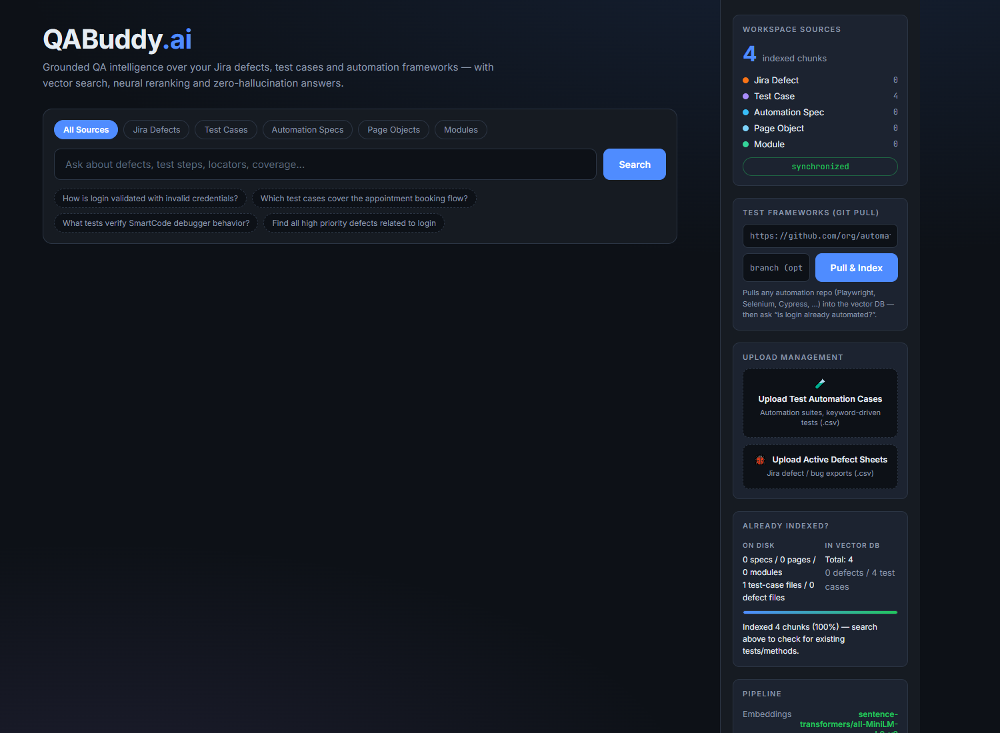
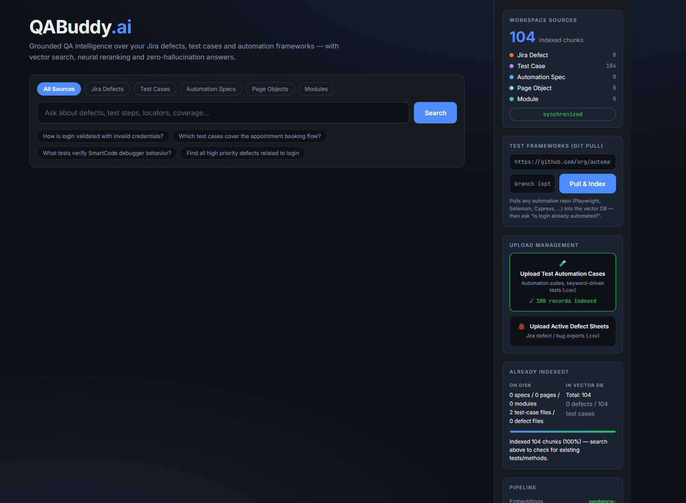
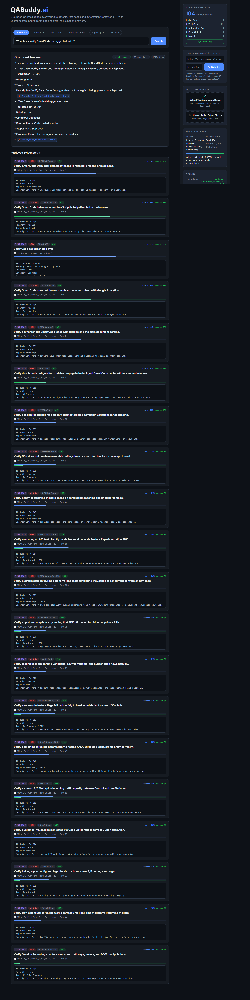

# QABuddy.ai — QA RAG Assistant

Grounded QA intelligence over your Jira defects, test cases and automation frameworks — with
vector search, neural reranking and zero-hallucination answers.

A local, runnable clone of the app at <https://qabuddy-rag.vercel.app/>, built faithfully on the
reference architecture (FastAPI + React/Vite + Qdrant), with one adaptation: embeddings default to
a **local** model so the app runs without a Google Gemini key.

```
question ─► embed ─► Qdrant vector search ─► rerank ─► grounded Groq answer + cited evidence cards
```

## Stack

| Layer | Choice |
|---|---|
| Frontend | React 18 + Vite 5 |
| Backend | FastAPI (Python 3.12) |
| Embeddings | Gemini `gemini-embedding-001` (768-d) by default; `fastembed` `all-MiniLM-L6-v2` (384-d) is an opt-in offline alternative |
| Vector DB | Qdrant — Cloud via `QDRANT_URL`, else the embedded local file store |
| Answer LLM | Groq chat completions, with a strict grounding guardrail |
| Reranker | Cohere Rerank v2 when a key is set, else the Groq-LLM fallback |

## Screenshots

1. Empty workspace (0 chunks) — 
2. After uploading a 100-row test-case CSV — 
3. A grounded answer with cited evidence cards — 

## Run locally

### Backend

```powershell
cd backend
python -m venv .venv
.\.venv\Scripts\Activate.ps1
pip install -r requirements.txt
uvicorn main:app --reload --port 8077
```

Embeddings default to the hosted Gemini model, so there is no model to download. For the offline
`EMBED_PROVIDER=local` path, also run `pip install fastembed onnxruntime` — the first run then
downloads the ONNX model once (Hugging Face cache).

### Frontend (dev)

```powershell
cd frontend
npm install
npm run dev          # http://localhost:5173  (proxies /api -> http://localhost:8077)
```

### Single-port (production-style)

```powershell
cd frontend; npm run build
cd ..\backend; uvicorn main:app --port 8077   # serves the built UI and the API on :8077
```

## Configure

```powershell
copy .env.example .env
```

Then set in `.env`:

- `GROQ_API_KEY` — required for answers and the LLM reranker fallback.
- `QDRANT_URL` + `QDRANT_API_KEY` — your Qdrant Cloud cluster. Required in production: without
  a URL the embedded file store is used, which is read-only/ephemeral on Vercel.
- `EMBED_PROVIDER` — `gemini` (default, needs `GEMINI_API_KEY`) or `local` (offline; installs
  `fastembed` + `onnxruntime` separately).

Switching `EMBED_PROVIDER` changes the vector dimension, so run **Full Reindex** afterwards.

## Add data

Use the sidebar zones in the UI:

- **Upload Test Automation Cases** → `.csv` (keyword-driven tests, suites).
- **Upload Active Defect Sheets** → `.csv` (Jira defect / bug exports).
- **Test Frameworks (git pull)** → paste any automation repo URL to clone + index its specs,
  page objects and modules.

CSV columns are auto-detected per row (`Summary` / `Title` / `Description` / `Test Case ID` /
`Issue key` / `TC Number` / `ID` for title & id; `Priority` / `Severity`; `Category` / `Type`).
Each non-empty row becomes one chunk cited as `[Source: file.csv - Row N]`.

## Tuning retrieval

`TOP_K` is how many top chunks get handed to the answer LLM, so it caps
*"list all / how many"* style questions. The `.env` defaults are tuned higher than the
reference app for larger files:

| Key | Value | Meaning |
|---|---|---|
| `RETRIEVE_TOP_K` | 50 | candidates pulled from Qdrant |
| `RERANK_TOP_N` | 30 | candidates sent to the reranker |
| `TOP_K` | 20 | chunks the answer LLM actually sees |

Raise `TOP_K` further for very large files (more context, slower answers); lower it for
faster, cheaper lookups. Restart the backend after changing them.

## News

Reproduced from the public reference project `github.com/poornimahebbar/qabuddy-rag`. The
Qdrant/Groq/FastAPI/React architecture, API contract, UI and parsing logic are theirs; the only
functional extension here is the optional offline embedding provider (Gemini is the default,
matching the reference).
